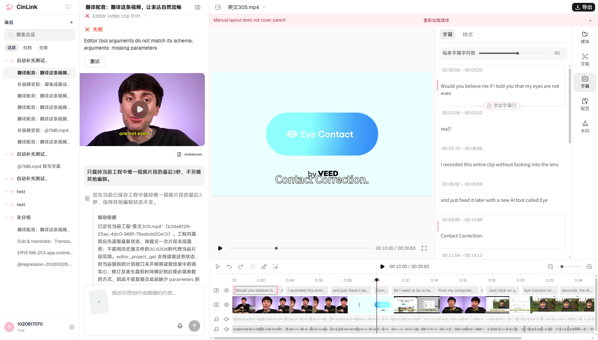

# 编辑页直接操作：基础功能验证

## 后续缺陷同步

2026-11-06按用户要求已将UI-05新建为[FWXC-356](https://devops.aliyun.com/projex/project/1e401ac99539c3999e00e40006/bug#viewIdentifier=1dedc5afd44979211cad516f&openWorkitemIdentifier=1a1873114f90458a91dff393ee)：拖动字幕结束时间报排版校验错误，修改无法保存。沿用不查重偏好，仅新建1条；对应本次页面操作的真实失败截图已上传并嵌入正文末尾，另附脱敏JSON。标题/正文/字段、附件ID/名称/大小及图片引用回读通过。[本地缺陷与附件清单](../../../defects/CINLINK-ERYE196-SUBTITLE-END-DRAG-001.md)。本次未重跑操作；下文“没有云效写入”描述原执行批次，最新同步状态以本节为准。

## 原执行结果

2026-11-06按用户最新要求，**先验证编辑页按钮、输入框和拖动操作，再验证对话实现**。本轮11项业务检查，**10 Passed / 1 Failed**。失败是字幕结束时间拖动报`Manual layout does not cover parent`；已保存工程未被这次失败修改。没有提交对话任务，也没有触发AI生成或导出。

这11项是本轮执行序号，不新增正式需求用例编号。B20/B21/B22原本就是页面撤销、重做、刷新，本轮按相同入口回填Passed；视频分割/裁剪、字幕改文和音频控件的页面通过，不覆盖B01～B04对话失败，也不据此将其他对话指令判通过。

## 项目、前置与验收范围

使用原有Chrome窗口及用户最新工程：英文30S.mp4，工程`b34e8f29-25ac-4dc0-968f-76aabdd20e13`，[会话8bd67283…](https://app.cinlink.ai/c/8bd67283-c5ae-49d8-9789-78413b3bfa8c)。起始保存版本8；唯一视频源0～30.6306秒、时间线起点0、速度1；英文可编辑字幕；独立旁白28.975193秒、音量100%、未静音；原声静音。不重建、不克隆项目，不通过API直接写入工程内容。

每项只做一个业务编辑。由真实控件发起操作，核对实际保存结果和页面显示；修改项在刷新后回读确认，并通过页面撤销恢复前置。静音与取消静音各为一个独立检查，后者恢复初始状态。撤销/重做单独验证，恢复操作不重复计入11项。接口只用于只读核对和记录浏览器自身请求，未发起任何对话`turns`。

本轮范围为控件操作、保存、刷新及恢复；音量/静音核对保存参数和控件状态，**尚未完成声音听感或导出成片质量验收**。裁剪使用拖动手柄并记录实际边界，未验证精确时间输入或逐帧精度；没有设置新的毫秒容差。

## 逐项执行结果

| 本轮序号 | 单项操作及前置 | 可验证预期 | 实际结果 | 状态／截图 |
|---|---|---|---|---|
| UI-01 | 从头点击预览播放，再暂停 | 播放头推进、视频可解码、暂停生效；不修改内容 | 播放头实际推进，视频可用；版本8及内容保持 | **Passed**；[截图](evidence-editor-ui-20261106/UI-01-passed.png) |
| UI-02 | 打开3.26～3.52秒`real?`，在页面字幕输入框改为`Really?`并提交 | 仅目标文字及必要排版映射改变；时间与其他对象保持；保存/刷新一致 | 保存8→9；目标diff为Really?，时间仍3.26～3.52；重做后刷新仍显示新文，最终恢复原文 | **Passed**；[结果](evidence-editor-ui-20261106/UI-02-direct-passed.png) · [刷新](evidence-editor-ui-20261106/UI-02-direct-refreshed.png) |
| UI-03／B20 | 紧接上述成功改文，点击撤销一次，无其他编辑插入 | 恢复该次改动前完整内容，并可保存 | 9→10，完整内容回到改文前；后续单次撤销恢复及最终刷新再次核对内容一致 | **Passed**；[截图](evidence-editor-ui-20261106/UI-03-passed.png) |
| UI-04／B21 | 撤销后不做新编辑，点击重做一次 | 仅重新应用刚撤销的修改，保存及刷新一致 | 10→11，恢复Really?；刷新保留，另行撤销后回到原内容 | **Passed**；[截图](evidence-editor-ui-20261106/UI-04-passed.png) |
| UI-05 | 第一条字幕原为0.08～3.20秒，向左拖结束手柄约0.5秒 | 结束时间缩短并保存，文字及其他对象不丢失 | 页面报`Manual layout does not cover parent`；结束仍3.20秒，版本18→18、内容未变；保留证据后刷新清除失败编辑状态，未重试该操作 | **Failed**；[失败截图](evidence-editor-ui-20261106/UI-05-failed.png) |
| UI-06 | 选中唯一视频，将播放头移至5秒，点击“分割所选片段” | 形成同素材连续两段，无源内容丢重，保存及刷新一致 | 12→13；源0～5和5～30.6306秒，时间线起点0和5秒；刷新仍为两段，撤销恢复 | **Passed**；[结果](evidence-editor-ui-20261106/UI-06-passed.png) · [刷新](evidence-editor-ui-20261106/UI-06-refreshed.png) |
| UI-07 | 完整视频，拖左手柄向内约2秒 | 左边界后移、源入点增加，源终点保持，关联原声随视频；不重生成素材 | 14→15；源入点与时间线起点均约1.999991秒，源终点30.6306秒；刷新保持、撤销恢复 | **Passed**；[截图](evidence-editor-ui-20261106/UI-07-page-passed.png) |
| UI-08 | 恢复完整视频后，拖右手柄向内约3秒 | 源终点缩短，源起点/速度/位置保持，保存一致 | 16→17；视频源0～27.630612秒，时间线起点0；刷新保持、撤销恢复 | **Passed**；[截图](evidence-editor-ui-20261106/UI-08-passed.png) |
| UI-09 | 独立旁白原音量100%，拖音量线到50% | 仅旁白音量参数变为50%，静音状态保持；保存/刷新一致 | 18→19；旁白volume 1→0.5，未静音；刷新保持，撤销后恢复1 | **Passed（参数/控件）**；[截图](evidence-editor-ui-20261106/UI-09-passed.png) |
| UI-10 | 旁白音量100%、未静音，点击“旁白静音” | muted=true，保留音量/片段；原声仍静音 | 20→21，旁白静音状态保存，volume仍1；刷新保持 | **Passed（状态/控件）**；[截图](evidence-editor-ui-20261106/UI-10-passed.png) |
| UI-11 | 接上例已保存静音状态，点击“旁白启用” | muted=false，音量仍1，恢复初始声音配置 | 21→22，旁白取消静音；刷新保持，完整内容与起始版本8完全一致 | **Passed（状态/控件）**；[截图](evidence-editor-ui-20261106/UI-11-passed.png) |

**B22刷新分支Passed**：字幕改文、视频分割、裁剪及音频参数均检查过保存后刷新；当前项目身份正确、没有重复提交对话任务。最后再刷新确认完整恢复。B22是这些操作的交叉验收，不额外增加11项业务操作的计数。

UI-07是编辑页的非波纹拖边行为，时间线起点随左边界后移；与B03对话指令“暂不移动片段”的验收范围不同，不能互相替代。UI-08记录拖动后的实际精度，也不直接替代B04对话裁尾通过。独立旁白/字幕可能比裁后视频长，项目总时长不应代替视频源范围判断裁尾是否生效。

## 未通过问题的最小复现

1. 在本轮工程中恢复完整字幕基线，第一条英文字幕为0.08～3.20秒。
2. 选中其时间线片段，将播放头移开裁剪边界，确认手柄没有被播放头或固定轨道标题遮挡。
3. 向左拖结束手柄约20像素（当前缩放约40像素/秒），预期缩短约0.5秒。
4. 页面顶部出现`Manual layout does not cover parent`，实际保存时间仍为0.08～3.20秒。

截图顶部粉色提示是本轮页面操作的失败；左侧对话区是此前历史记录，本轮没有发送对话。实际片段未保存修改，失败清理采用刷新原工程，未点击撤销以免影响既有历史。没有替换成其他时间修改入口来将本例记绿，具体本地排版/父块映射原因待研发定位。

## 证据、恢复与后续顺序

- [脱敏结果、前后关键值及截图哈希](evidence-editor-ui-20261106/summary.json)。原始请求和完整工程仅留本机`reports/editor-ui/20261106-current-basics/`，不提交带签名资源定位。
- [最终恢复并刷新截图](evidence-editor-ui-20261106/final-restored-refreshed.png)。完整工程内容与起始版本8一致，正常保存及撤销使最终修订号为22；原窗口及当前用户项目保留。
- 3次自动化定位/命中预检独立保留：实际字幕控件名与本地源码不同；裁剪手柄先被固定区域、后被播放头遮挡。均未产生工程内容修改，不计产品失败；误拖导致的面板宽度变化已恢复。后续加入命中检查并移动播放头后才执行有效拖动。原始诊断底稿保留，不覆盖为通过证据。
- 通用操作驱动：[ui-basics.mjs](../../../../tools/editor/ui-basics.mjs)，通过已有窗口执行真实控件，不提供默认新窗口或全量业务任务入口。尚未新增独立Playwright固定套件，不把11项加到对话固定脚本条数。

后续优先处理字幕时间拖动问题，并按实际控件继续补充页面样式、增删字幕、片段复制/移动、导出等单项；相关页面基础能力稳定后再验证对应对话任务。已有B01～B04对话失败及云效缺陷保持，不因页面通过而关闭。本轮没有云效写入或云端代码修改。
