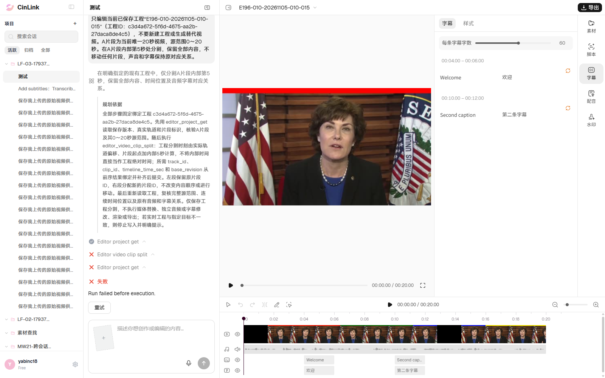
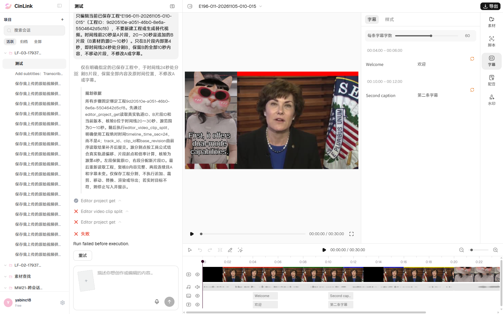
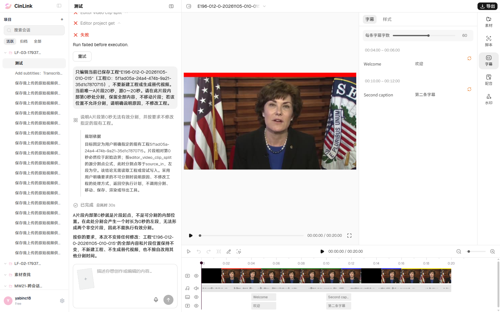
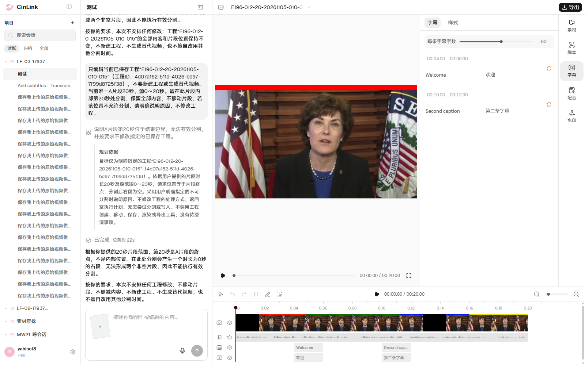
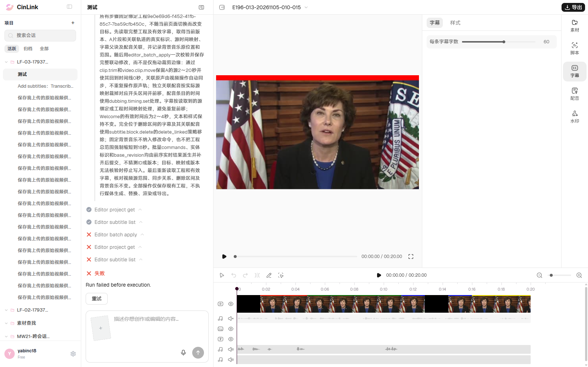
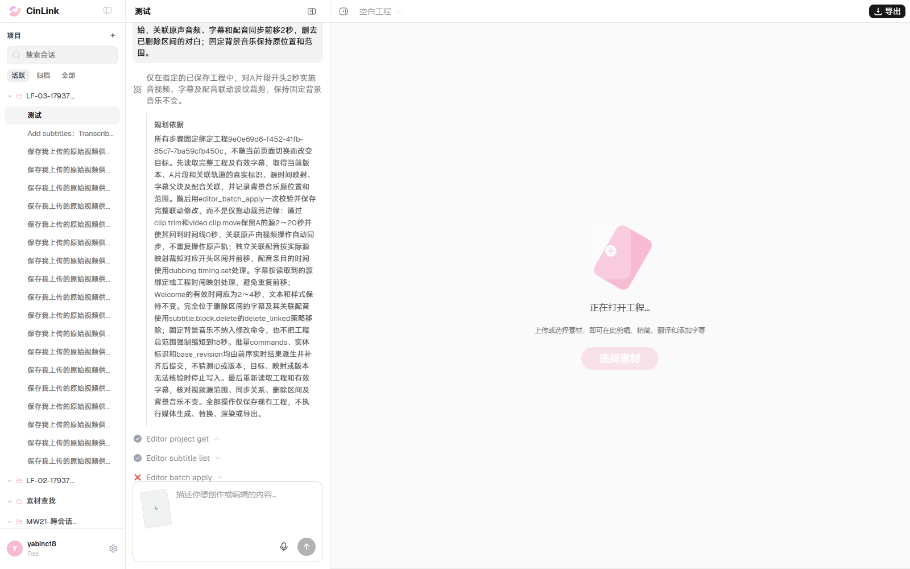

# ERYE196-010～015 自动化与有头执行记录

> 后续013～015已完成完整夹具复跑：013/014 Failed、015 Passed，原3条Blocked解除。[最新结果与截图](results-013-015-rerun-20261105.md)。本文保留首轮历史，不再作为当前阻塞依据。

日期：2026-11-05，Asia/Shanghai。脚本覆盖6条用例，012含0秒/20秒两个独立分支。用户允许新开Chrome并完成人工登录，实际操作串行、单worker、零业务重试；按页面业务及真实保存结果验收。

**本轮业务结果：1 Passed / 2 Failed / 3 Blocked。** 012通过；010、011未通过；013因夹具问题修正后待复测，014、015因工程接口持续超时尚未提交目标指令。不能把测试进程的初始化失败计作产品剪辑失败，也不能把“任务失败但未修改”算参数校验通过。

196共134条最新：**4 Passed / 2 Not Applicable / 6 Failed / 3 Blocked / 119 Not Run**。001/003/009及002/004既有结果保持，005～008原失败保持，016～134未执行。206/210本轮未执行；三需求255条合计4 Passed / 2 Not Applicable / 6 Failed / 3 Blocked / 240 Not Run。

## 脚本与实际执行范围

- [固定Playwright脚本](../../../../tests/editor/erye196-editing.spec.ts)、[夹具与页面操作](../../../../tools/editor/erye196.ts)、[独立有头配置](../../../../playwright.editor.config.ts)。命令`npm run test:editor:196`；前置音频生成、登录及定向运行见[说明](../../../../tools/editor/README.md)。默认不并入全量staging。
- 第一轮完整启动6例，控制台为1 passed / 5 failed；其中013已受理，014/015仅初始化失败。随后只对未受理的014/015执行定向恢复，两例仍在60秒工程读取处超时，没有重复提交010～013的原任务。
- 共受理5个run：010、011、012两个端点、013。010/011/013终态failed，012两个端点均done。无人工重试按钮操作，无重复裁剪；013后续仅回读原run消息。
- 原始证据本机目录`reports/editor-196/20261105-010-015/`；后续定向控制台在`reports/editor-196/remaining-console-local.log`。部分原始Playwright错误含本机认证请求头，原始报告只留本机，不进入提交物；本文及精选截图不包含凭据。

## 逐例结果

| 用例 | 业务结果 | 实际观察与验收边界 |
|---|---|---|
| 010 主片5秒分割 | Failed | 当前唯一A20已显示且真实请求已受理；分割工具报参数不完整，页面显示通用失败。保存后仍1段、源0～20秒，版本1，未完成5秒分割。没有进入跨切点播放、帧连续性和声音同步验收 |
| 011 追加B内部4秒分割 | Failed | A20+B的源0～10秒追加为30秒；只分B的请求已受理，但分割工具报参数不完整。工程内容及版本1保持，未形成20～24/24～30两段；未进入跨切点效果验收 |
| 012 0秒/20秒端点分割 | Passed | 两份独立工程均明确说明端点分割会产生零时长片段，未安排编辑；两个run均done，完整工程内容及版本1保持，没有新增保存版本。未独立验证底层历史存储实现 |
| 013 裁头与字幕配音同步 | Blocked | 首次夹具保存成功，但未登记逐句配音关联，原run返回`Stored project format is unsupported.`。这是本轮测试夹具问题，不据此判产品裁剪失败。已补齐真实独立句音频、字幕对应关系及配音控制轨；随后工程读取持续超时，修正后的夹具及目标操作尚未云端复测；原run终态已从消息回读为failed，工程最终内容未成功回读 |
| 014 跨边界字幕及保留讲话 | Blocked | 未受理目标run；工程初始化GET持续超时，20/60秒窗口均未恢复。跨边界字幕删除/新增、独立Intro及Remove Keep配音夹具已接代码，尚未验证云端准备及剪辑效果 |
| 015 超范围裁头 | Blocked | 未受理目标run；工程初始化GET持续超时。不能据此判断21秒裁头是否被正确拒绝，亦不计负向用例通过 |

## 账号、会话与素材前置

- 环境staging-app.cinlink.ai，账号yabinc18；复用既有测试会话`bb4f1a9a-c3fb-4de0-aa25-f48f15621303`，每轮在提示词明确工程名称和ID，不使用不存在的对象引用标签。
- A复用已登记`E196-A.mp4`，20秒、1920×1080、30fps，源0～20秒；基线工程`95bac85e-de3f-43d1-adfa-7e1f1e87054c`。原文字幕Welcome为4～6秒、Second caption为10～12秒，含对应译文。不是以需求拟定接口构造验收条件。
- B取不同视频“张雅婷(Tin)分享的视频.mp4”的源0～10秒，放在A后20～30秒；完整B源实际约120.333秒，不把它误记为10秒源文件。
- 013修正后：原声音轨替换为独立20秒控制音频，仅前3秒为Intro/Remove/Keep，后续为静音；另有Welcome、Second caption两份2秒真实WAV，分别关联4～6、10～12秒字幕；固定BGM20秒。014采用Intro 0～1、Remove Keep 1～3秒的独立配音及字幕。离线语音用于观察词句及时间变化，不代表自然口型/音质验收。
- 夹具创建使用当前真实保存入口，并按真实响应补充会话关联。待测编辑始终从Agent输入框提交，不直接保存期望结果来冒充通过。用户原工程不作为待测编辑目标；012结束时回读原工程仍版本9、内容不变，013之后因接口超时未完成最终原工程复核及视图恢复。

## 真实任务定位

| 分支 | 工程ID | run_id | 终态 |
|---|---|---|---|
| 010 | c3d4a672-5f6d-4675-aa2b-27daca8de4c5 | run_v2_63091c6f9a8d441d8244be4f411293d9 | failed |
| 011 | 9d20510e-a051-46b0-8e6a-5504642d5cf8 | run_v2_14bba7b724544197a7a20200ccd5dfed | failed |
| 012-0 | 5f1ad05a-24a4-474b-9a21-35d1c7870715 | run_v2_96213009966444afab8a356d1728af41 | done |
| 012-20 | 4d07a162-511d-4026-bd97-7f99d8725f38 | run_v2_2c0a3b93260f4f2dba2dacce111eee69 | done |
| 013 首次夹具 | 9e0e69d6-f452-41fb-85c7-7ba59cfb450c | run_v2_82b6c7ffa9d84b53a50ee0b9b2b328cf | failed；夹具修正待复测 |

010真实错误：`Editor tool arguments do not match its schema; parameters: missing track_id, clip_id, timeline_time_sec`。011为`parameters: missing track_id, clip_id`。页面两例均显示`Run failed before execution.`；本次判失败的依据是用户要求的分割没有完成，具体参数错误仅作研发定位信息。既有FWXC-317是字幕改文失败，是否同根因尚未确认，本轮没有新建或更新云效缺陷。

012-0回复：“第0秒就是片段起点……会产生一个时长为0秒的左段……本次不安排任何修改。”012-20回复：“第20秒是A片段的终点……会产生一个时长为0秒的右段……本次不安排任何工程修改。”均与前后完整保存内容对照，未以泛化失败替代端点校验。

## 真实截图

截图直接复制自对应批次原图，未编辑画面。

010分割失败：

011追加B分割失败：

012起点、终点明确拒绝并保持原工程：

013首次夹具失败现场，不作为修正后业务失败证据：

014/015共用的工程读取阻塞现场为最后一次015初始化截图；没有014独立目标执行截图，因目标指令未提交，不将本图冒充014剪辑失败：

## 续跑条件

恢复工程读取/保存后，先用修正后的逐句配音夹具执行013，再执行014、015：`npm run test:editor:196 -- --grep 'ERYE196-01(3|4|5)'`。013采用新独立工程，不重试旧错误夹具的run；先核对原工程最终内容与视图。010/011不用为补证据再次提交。后续调用会按批次及调用时间分别保留JSON/HTML，避免覆盖原报告。

本轮类型检查通过，`npm run cases:check`检查543条用例、0问题；未重复跑全量离线校验。013/014修正后的夹具由实际构建代码在本机生成，再按当前实现校验结构及关联，均有效；使用的句音频占位ID未上传，该项只证明本地夹具结构，不代表云端素材或业务通过。证据在本机`fixture-repair-validation.json`。先前已执行脚本全部见[脚本清单](automation.md)。
