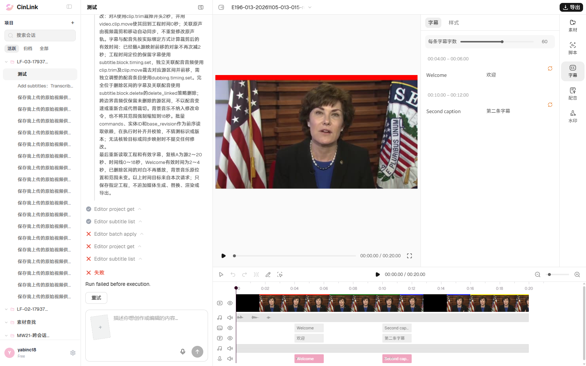
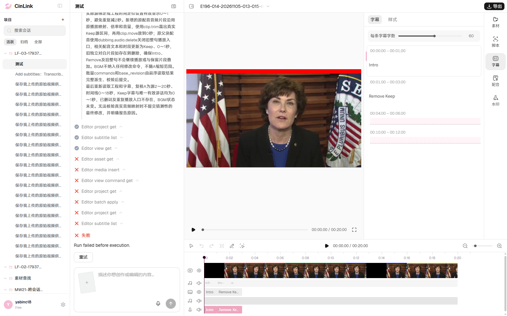
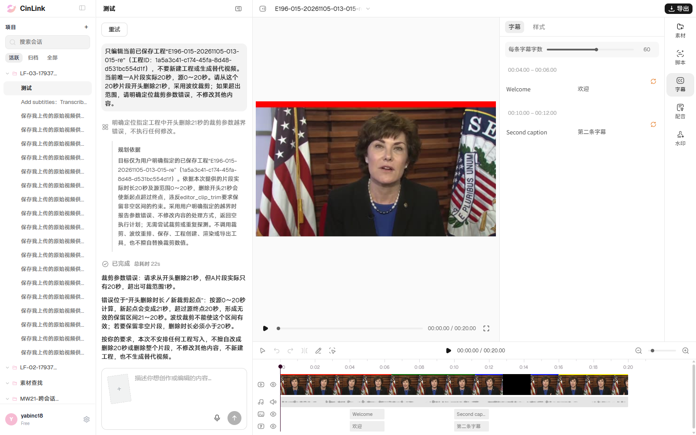

# ERYE196-013～015 修正夹具后的有头复跑

日期：2026-11-05，Asia/Shanghai。用户明确要求重新执行013～015；复用有效登录态，新建三个独立测试工程，有头Chrome、串行、单worker、零重试。

**本轮1 Passed / 2 Failed / 0 Blocked。** 013、014已完成有效前置并真实受理，之前的接口超时已恢复；015按明确的超范围反馈及原工程保持验收。旧错误夹具及原run保留，不覆盖历史。

196共134条最新：**5 Passed / 2 Not Applicable / 8 Failed / 0 Blocked / 119 Not Run**。三需求255条最新：5 Passed / 2 Not Applicable / 8 Failed / 0 Blocked / 240 Not Run；206/210本轮没有新执行。

## 结果

| 用例 | 本轮结果 | 业务观察 |
|---|---|---|
| 013 裁头并同步字幕/配音 | Failed | 已有两份真实逐句配音及字幕关联、固定BGM；任务失败，A仍源0～20秒，Welcome仍4～6秒、Second caption仍10～12秒，未形成裁头后同步结果；完整内容和版本1保持 |
| 014 跨边界字幕及保留讲话 | Failed | Intro 0～1秒、Remove Keep 1～3秒及对应独立配音均已就绪；素材读取失败，裁剪未完成；原视频、文字/时间及配音关系保持，未进入新0～1秒的效果验收 |
| 015 删除21秒超过20秒片段 | Passed | 真实回复明确拒绝超出片段范围，不执行修改；任务done，完整工程内容及已保存版本1保持，没有产生空片段或新增保存版本 |

## 本轮前置与执行边界

- 环境staging-app.cinlink.ai，账号yabinc18，会话`bb4f1a9a-c3fb-4de0-aa25-f48f15621303`；逐条明确工程名称和ID，不强制对象引用标签。
- 013已补齐Welcome 4～6秒、Second caption 10～12秒的两份独立2秒WAV，逐句配音状态ready，与真实字幕绑定；独立配音控制轨存在。源控制音频前3秒为Intro/Remove/Keep，固定BGM20秒。
- 014已删除原基线两条字幕后增加Intro 0～1秒及Remove Keep 1～3秒，对应1秒及2秒独立WAV；两条逐句配音均ready，原声音轨静音，固定BGM独立。不能把这些准备动作当剪辑通过。
- 本轮6份控制音频仅上传一次，三个目标请求各提交一次，没有用UI重试替代原任务；没有触发补槽或计划人工确认。
- 013/014真实失败发生在已实现工具调用中，按用户要求的裁剪未完成判失败；工具参数错误只作排查线索，不拿需求拟定接口设计当通过条件。没有对云端源码作修改。
- 015仅读取助手回复作为拒绝证据，不拿用户提示词中的“超出范围”自证校验通过；未单独验证底层历史存储实现。费用/余额未核验。
- 用户原工程最终回读内容保持、版本9不变；测试浏览器原工程视图恢复：未确认，见本机记录。

## 真实任务与排查线索

| 用例 | 工程ID | run_id | 终态 |
|---|---|---|---|
| 013 | c5c1a33d-8202-4bbd-8717-eb2d39026927 | run_v2_dcd5d3637ce44213b42dcc2a59be242c | failed |
| 014 | 02e00905-01e4-4bc6-9b13-974603dc6691 | run_v2_a831255406214331826115ede6cdf0ba | failed |
| 015 | 1a5a3c41-c174-45fa-8d48-d531bc554d1f | run_v2_d1c409504cea41f994a75ea96cfae84a | done |

013：`editor_batch_apply`：`Editor tool arguments do not match its schema; arguments: missing commands`。

014：`editor_asset_get`：`Editor tool arguments do not match its schema; arguments: missing file_ids`。

013/014页面错误均为`Run failed before execution.`。013与上轮`Stored project format is unsupported.`不同，原配音夹具问题已排除；014为新增有效执行记录。没有自动向云效提交或合并缺陷，既有FWXC-317不能仅凭相同页面提示认定同根因。

015助手实际回复：

> 裁剪参数错误：请求从开头删除21秒，但A片段实际只有20秒，超出可裁范围1秒。
>
> 错误位于“开头删除时长／新裁剪起点”：按源0～20秒计算，新起点会变成21秒，超过源终点20秒，形成无效的保留区间21～20秒。波纹裁剪不能使这个区间有效；若要保留非空片段，删除时长必须小于20秒。
>
> 按你的要求，本次不安排任何工程写入，不擅自改成删除20秒或删除整个片段，不修改其他内容，不新建工程，也不生成替代视频。

## 完整提示词

**ERYE196-013**

只编辑当前已保存工程“E196-013-20261105-013-015-re”（工程ID：c5c1a33d-8202-4bbd-8717-eb2d39026927），不要新建工程或生成替代视频。当前A片段20秒，源0～20秒，原文字幕Welcome位于4～6秒，关联配音轨与A同源定位，背景音乐轨固定从0秒开始。只从A片段当前开头删除2秒，采用波纹裁剪；保留视频从时间线0秒开始，关联原声音频、字幕和配音同步前移2秒，删去已删除区间的对白；固定背景音乐保持原位置和范围。

**ERYE196-014**

只编辑当前已保存工程“E196-014-20261105-013-015-re”（工程ID：02e00905-01e4-4bc6-9b13-974603dc6691），不要新建工程或生成替代视频。当前A片段20秒，源0～20秒。字幕Intro在0～1秒，Remove Keep在1～3秒；真实配音Intro为0～1秒、Remove为1～2秒、Keep为2～3秒。请从A开头波纹裁剪2秒，视频、关联字幕和配音同步，固定BGM不移动。删除Intro和Remove，只保留Keep并使其字幕及讲话在新时间线0～1秒，不要保留已删词或重复词。

**ERYE196-015**

只编辑当前已保存工程“E196-015-20261105-013-015-re”（工程ID：1a5a3c41-c174-45fa-8d48-d531bc554d1f），不要新建工程或生成替代视频。当前唯一A片段实际20秒，源0～20秒。请从这个20秒片段开头删除21秒，采用波纹裁剪；如果超出范围，请明确定位裁剪参数错误，不修改其他内容。

## 真实截图

截图为本轮原始页面截图的直接副本，SHA256与原图一致。

**013 Failed**

**014 Failed**

**015 Passed**

## 脚本、报告和校验

- [固定测试](../../../../tests/editor/erye196-editing.spec.ts)、[夹具及操作](../../../../tools/editor/erye196.ts)、[已执行脚本清单](automation.md)。本次命令`npm run test:editor:196 -- --grep 'ERYE196-01(3|4|5)'`。
- 本机证据`reports/editor-196/20261105-013-015-rerun/`：各例前后工程、提示词、真实受理、对应消息及截图，另有本次时间戳JSON/HTML报告；控制台`reports/editor-196/rerun-013-015-console-local.log`。原始证据只留本机，精选截图与结论进入用例文档。
- 定向类型检查通过；本次用例状态更新后执行`npm run cases:check`，不重复跑整套离线校验。
- [上一轮010～015记录](results-010-015-ui-20261105.md)保留当时1 Passed / 2 Failed / 3 Blocked，当前以本页复跑结果为准。
