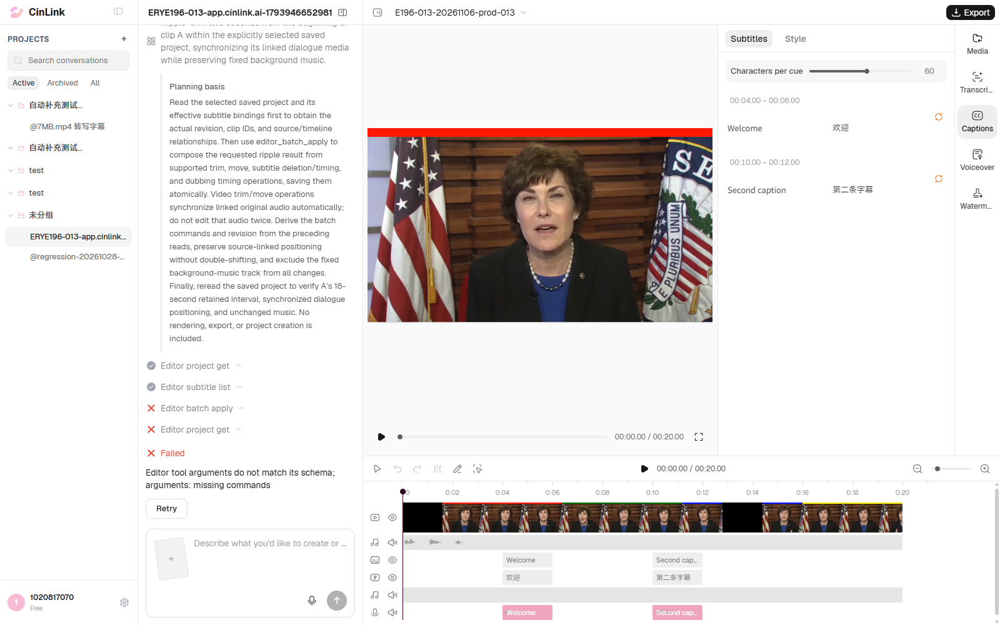

# ERYE196-013 正式环境执行记录

## 后续缺陷同步

2026-11-06按用户要求跳过去重直接新建[FWXC-339](https://devops.aliyun.com/projex/project/1e401ac99539c3999e00e40006/bug#viewIdentifier=1dedc5afd44979211cad516f&openWorkitemIdentifier=5275c98586194aeef2136a8454)：【正式环境】Agent裁头并同步字幕/配音失败，批量编辑调用缺少commands。1张本轮真实失败截图已上传并嵌入正文末尾，另附1份脱敏JSON；正文/字段/附件ID名称字节数及图片引用均回读核验通过。[本地缺陷及截图清单](../../../defects/CINLINK-ERYE196-RIPPLE-TRIM-001.md)。本次仅同步缺陷，没有重跑任务或改变Failed结论；下文“没有新建云效缺陷”指原测试执行批次。

日期：2026-11-06，Asia/Shanghai。用户明确指定正式环境[https://app.cinlink.ai/](https://app.cinlink.ai/)，已人工登录并使用有头Chrome执行一次013；正式编辑请求于14:33:05提交。

**结果：Failed，0通过 / 1未通过 / 0阻塞。** 工程及字幕读取成功，批量编辑调用因缺少`commands`失败；未完成裁头及字幕/配音同步，完整工程内容和版本1保持。与2026-11-05预发013观察到相同缺参错误；仅凭错误一致不能断定底层同根因。

正式环境013与预发013均Failed。原预发134条统计仍为5 Passed / 2 Not Applicable / 8 Failed / 0 Blocked / 119 Not Run；本次没有新增用例编号，不将同一用例的第二环境执行重复加进134条数量。

## 前置与实际操作

- 地址app.cinlink.ai，页面账号显示1020817070；界面为英文，提示词为中文。使用独立正式环境登录文件，没有覆盖预发登录文件。
- 在正式环境创建独立会话、A20控制工程和013测试副本；本轮没有打开或编辑已有客户工程。控制工程`81ceb4f6-02d0-471c-abf5-5f1b84f95209`最终内容及版本1保持，测试浏览器已恢复到该控制工程。
- 重新通过正式环境文件服务登记A20视频及两份SRT。A20为20秒、1920×1080、30fps；Welcome字幕4～6秒、Second caption字幕10～12秒及对应译文。所有素材ID均来自本轮正式环境真实上传响应；同内容文件去重后可能返回相同ID，不以ID相同断言跨环境复用。
- 六份真实离线WAV已登记；本例使用20秒源控制音频、固定20秒BGM、Welcome/Second caption两份2秒逐句配音。两条配音均为ready，与原文字幕关联；配音控制轨齐备。
- 在已保存的013副本中，通过聊天输入框一次发送下方完整指令；无补槽、无人工计划确认、无业务重试，不直接保存期望编辑结果来替代Agent执行。
- 开始准备时，旧上传路径返回404；改为正式页面实际部署包使用的`/cloud-tool-api/v1/agent/files`。随后将中文按钮文案定位改为中英文通用选择器。这两次均为准备阶段，未发送013目标指令；已有控制工程随后复用，未重复创建。

## 提示词

只编辑当前已保存工程“E196-013-20261106-prod-013”（工程ID：f6366c0e-45a4-4d21-b406-0fb2bde18e1e），不要新建工程或生成替代视频。当前A片段20秒，源0～20秒，原文字幕Welcome位于4～6秒，关联配音轨与A同源定位，背景音乐轨固定从0秒开始。只从A片段当前开头删除2秒，采用波纹裁剪；保留视频从时间线0秒开始，关联原声音频、字幕和配音同步前移2秒，删去已删除区间的对白；固定背景音乐保持原位置和范围。

## 实际结果与排查信息

| 项目 | 本轮值 |
|---|---|
| 会话ID | 7cd3e2dc-f9d5-42f4-8947-b1fa21830c12 |
| 测试工程ID | f6366c0e-45a4-4d21-b406-0fb2bde18e1e |
| run_id | run_v2_bfff18f172f942f7a538ff8ebee99141 |
| trace_id | 2173a842-6b2d-4c8b-a4ca-e8957be5b06a |
| 受理/终态 | HTTP 200，queued → failed |
| 工程读取 | editor_project_get：done |
| 字幕读取 | editor_subtitle_list：done |
| 失败操作 | editor_batch_apply：failed / INVALID_ARGUMENT |
| 页面及工具错误原文 | Editor tool arguments do not match its schema; arguments: missing commands |
| 工程变化 | 完整内容不变；版本1 → 1 |

本次批量编辑的真实调用参数如下；没有具体编辑操作列表：

```json
{
  "project_id": "f6366c0e-45a4-4d21-b406-0fb2bde18e1e",
  "operation_id": "e8a734c1-952b-4a09-89b1-630e659177e4",
  "plan_node_id": "trim-a-head-two-seconds_2_editor_batch_apply"
}
```

视频仍为源0～20秒、时间线0～20秒；Welcome仍4～6秒，Second caption仍10～12秒，对应配音仍在原位置，固定BGM也未变化。当前只能确认编辑未执行，未进入裁剪后播放、删词、字幕与配音同步效果验收。未核验费用/余额。

期望：视频保留源2～20秒并从时间线0秒开始；两句字幕及配音分别移到2～4秒、8～10秒；已删除区间对白不残留，固定BGM的位置和范围保持。固定BGM可仍延续到20秒，不把总工程时长必须18秒当验收条件。

## 失败截图

本图为本次正式环境任务的真实页面原图副本，未编辑，SHA256：`857ccef1fbef711faa59323fdc58f82f61248d93c8c931c7f07e5c2874f4fe45`。



## 脚本与证据

- [013自动化](../../../../tests/editor/erye196-editing.spec.ts)、[当前环境夹具准备](../../../../tools/editor/provision.ts)、[执行说明](../../../../tools/editor/README.md)。命令为`npm run test:editor:196 -- --grep 'ERYE196-013'`，本轮单worker、零重试；使用正式环境URL、文件服务路径和独立登录态。
- 本机原始证据`reports/editor-196/20261106-prod-013/`：真实前后工程、提交、run消息、环境登记、截图及本次时间戳JSON/HTML；控制台`reports/editor-196/prod-013-console-local.log`。认证、签名链接及原始报告只留本机。
- 类型检查及需求用例检查在本轮代码/文档更新后执行；没有重复跑全量离线校验。
- 本轮没有修改云端代码，没有向云效新建或更新缺陷。[预发013～015对照记录](results-013-015-rerun-20261105.md)。
