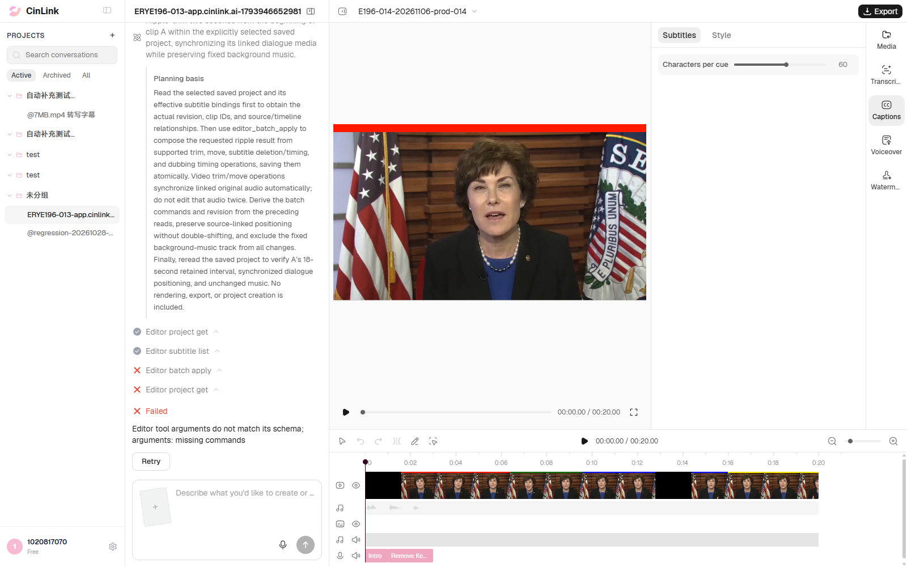

# ERYE196-014 正式环境执行记录

> 后续已在用户手动创建的自然素材工程复测，并按要求执行单视频S1诊断；两者均有工具调用且分别缺commands、track_id/clip_id。[用户项目最新记录与截图](results-014-user-project-20261106.md)。本文保留原模拟逐句配音项目的done无计划历史，不作为最新014卡点。

日期：2026-11-06，Asia/Shanghai。按用户要求，在[正式环境](https://app.cinlink.ai/)使用有头Chrome执行014；14:53:36提交一次目标请求，单worker、零重试。

**用例结果：Failed（0通过 / 1未通过 / 0阻塞）；任务终态：done。** 助手表示现有配音条目操作未提供显式音源裁切，无法安全完成这组同步编辑，未生成执行计划。页面显示Completed，但`intent_fully_satisfied=false`、执行计划为空；裁头及跨边界字幕/讲话同步没有完成，完整工程内容及版本1保持。预发014为editor_asset_get缺file_ids；本轮没有工具调用或缺参错误，表现不同，不能沿用预发原因。

本轮仅增加014在正式环境的一次执行记录，不新建用例编号。预发134条统计仍为5 Passed / 2 Not Applicable / 8 Failed / 0 Blocked / 119 Not Run；正式已执行013/014，均Failed，按环境单列。

## 前置与实际操作

1. 复用正式环境独立登录态和已有测试会话`7cd3e2dc-f9d5-42f4-8947-b1fa21830c12`，页面账号1020817070、英文界面；控制工程`81ceb4f6-02d0-471c-abf5-5f1b84f95209`仅作独立基线，不编辑已有客户工程。
2. 从20秒、1920×1080、30fps的A20基线创建本轮独立工程`E196-014-20261106-prod-014`（`24c1f8d0-45ce-4993-8a08-38a95634663b`）。不是在013失败工程上继续裁剪。
3. 将原基线两条字幕删除后，准备Intro字幕0～1秒、Remove Keep字幕1～3秒；真实配音Intro位于0～1秒、Remove位于1～2秒、Keep位于2～3秒。对应两份独立句音频分别为1秒及2秒，两条配音均ready并与字幕绑定；原声音轨静音，独立固定BGM为0～20秒。
4. 由正式环境文件服务登记本轮控制音频，回读并在页面确认Remove Keep存在后，一次发送下方完整指令。不@视频，无补槽或人工计划确认，不点击失败重试。

## 提示词

只编辑当前已保存工程“E196-014-20261106-prod-014”（工程ID：24c1f8d0-45ce-4993-8a08-38a95634663b），不要新建工程或生成替代视频。当前A片段20秒，源0～20秒。字幕Intro在0～1秒，Remove Keep在1～3秒；真实配音Intro为0～1秒、Remove为1～2秒、Keep为2～3秒。请从A开头波纹裁剪2秒，视频、关联字幕和配音同步，固定BGM不移动。删除Intro和Remove，只保留Keep并使其字幕及讲话在新时间线0～1秒，不要保留已删词或重复词。

## 实际结果

| 项目 | 本轮值 |
|---|---|
| 测试工程ID | 24c1f8d0-45ce-4993-8a08-38a95634663b |
| 会话ID | 7cd3e2dc-f9d5-42f4-8947-b1fa21830c12 |
| run_id | run_v2_321ed216eb75418b8b51f2e019212d78 |
| trace_id | 5b1bebd0-dfab-41af-84e1-7ee85161230b |
| 受理 / 任务终态 | HTTP 200，queued → done；页面Completed |
| 需求满足标记 | intent_fully_satisfied=false |
| 执行计划 / 工具调用 | plan=[]，0次；没有工具调用失败或错误码 |
| 助手说明 | 无法安全表达完整的配音源裁切及同步修改；不安排部分编辑或替代流程 |
| 保存结果 | 完整工程内容保持，版本1 → 1 |

助手关键原文：

> I cannot safely encode the complete synchronized edit with the supplied controls. Dubbing entries support text changes, retiming, deletion and playback resizing, but not an explicit audio-source cut.

助手解释Remove与Keep共用一段录音时，移动、缩短或变速可能保留/压缩Remove，不能替代删除原音源中的词；当前信息也未证明Keep是可独立裁切的音频片段。因此没有下发编辑计划，连Agent工程读取步骤也未执行。自动化准备阶段的真实工程回读与此区分记录。

这只是本轮Agent的规划及能力判断，未通过独立手动操作或真实裁音调用确认底层功能缺失，根因仍待定位。没有把字幕改写、重新合成配音或生成替代视频当作本例通过。

视频仍为源0～20秒、时间线0～20秒；Intro仍在0～1秒，Remove Keep仍在1～3秒，对应配音及固定BGM均保持。因为剪辑没有执行，本轮未进入裁剪后实际播放、保留词准确性或音画同步效果验收，不据此宣称同步算法有误。费用/余额未核验。

独立控制工程最终回读内容及版本1保持，测试浏览器已恢复该控制工程视图。原始失败任务及独立副本保留供排查，没有用新任务替换其结果。

## 预期结果

从A开头波纹裁剪2秒：保留视频源2～20秒并从时间线0秒开始；原0～1秒的Intro整句删除，原1～2秒的Remove删除，原2～3秒的Keep及对应字幕/讲话出现在新0～1秒；无已删词残留、漏词、重复或声音错位，保存重开结果一致。固定BGM位置及范围不动；允许其延续到20秒，不强制总工程时长等于视频18秒。

## 真实截图

本轮前置，包含Intro/Remove Keep及配音关系：

本轮用例未完成现场：页面Completed、助手说明无法执行，工程仍为20秒；原图直接复制，未加工画面：

失败原图SHA256：`d25f2ca8155b92cf802250c6fffd5348b5cbd9ed3521c74d48b01f5b0defb8b0`；本地原图与本文副本一致。

## 脚本、报告与状态

- [自动化014](../../../../tests/editor/erye196-editing.spec.ts)，命令`npm run test:editor:196 -- --grep 'ERYE196-014'`，使用正式URL、`/cloud-tool-api/v1/agent/files`及独立登录文件；复用控制工程与会话，新建014副本。字幕面板打开操作已按展开状态执行，兼容英文界面。
- 本机证据`reports/editor-196/20261106-prod-014/`包含完整前后工程、提示词、真实受理、原run消息、控制音频登记、截图及本次JSON/HTML；控制台`reports/editor-196/prod-014-console-local.log`。原始报告、凭据及签名URL不提交。
- 类型检查和用例状态检查在本次代码/文档更新后执行；不重复跑全量离线校验。
- 本轮未新建或更新云效缺陷，未修改云端代码；[正式013及FWXC-339记录](results-013-prod-20261106.md)保留，不能自动视为014已同步缺陷。[预发014对照记录](results-013-015-rerun-20261105.md)。
