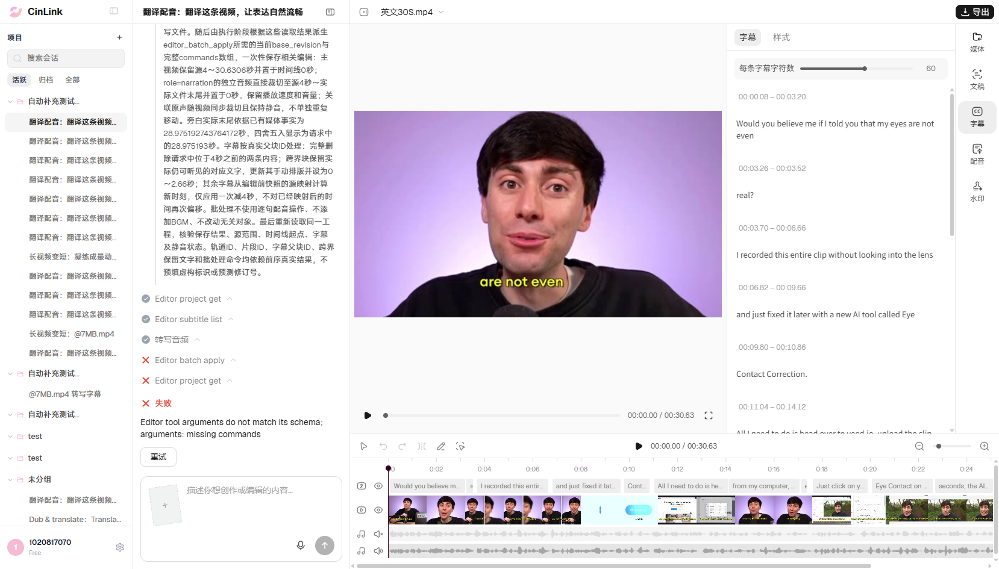
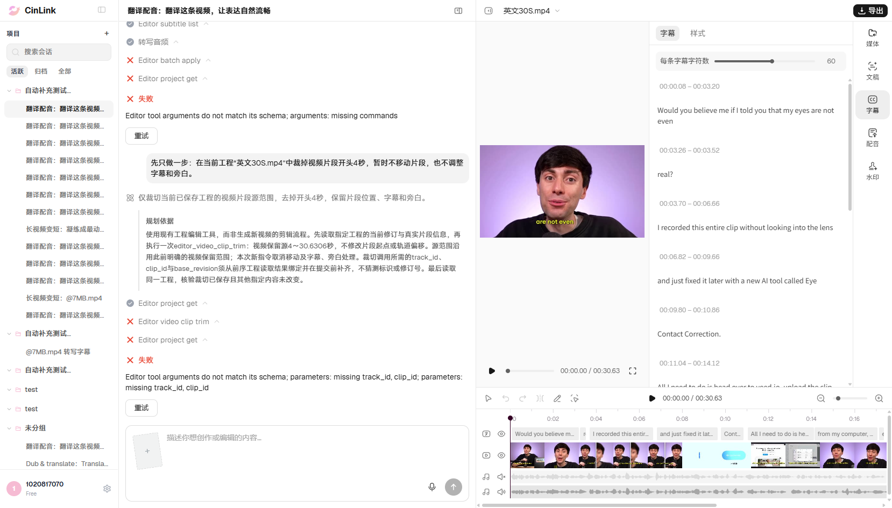

# 用户自建项目014复测与单步诊断

## 后续缺陷同步

2026-11-06按用户要求已将S1单视频裁头失败新建为[FWXC-347](https://devops.aliyun.com/projex/project/1e401ac99539c3999e00e40006/bug#viewIdentifier=1dedc5afd44979211cad516f&openWorkitemIdentifier=83eea6f9c327d3ab2a909205f7)，沿用无需查重偏好。1张对应本轮真实失败截图已上传并在正文末尾嵌入，另附1份脱敏JSON；正文/字段、2附件ID名称字节数和图片引用回读均通过。[本地缺陷及证据清单](../../../defects/CINLINK-ERYE196-VIDEO-TRIM-001.md)。本次没有重跑或改变失败结论，未修改FWXC-339；下文“未提交云效”仅描述原测试批次。

日期：2026-11-06，Asia/Shanghai。用户手动创建“英文30S.mp4”并指定为后续测试项目；复用原有头浏览器及当前选中工程，未创建替代项目或用旧夹具JSON覆盖。

**014自然素材变体：Failed。单步S1“只裁视频开头4秒”：Failed。** 两次不同范围的请求各发送一次，无补槽或业务重试；原工程完整内容和版本2均保持。S1失败后停止，旁白、字幕等后续单项未继续执行。

定位已从“组合编辑未完成”缩小到**单个视频裁剪工具也缺少目标参数**：工程读取成功后，`editor_video_clip_trim`收到的参数只有源入点/出点，没有`track_id`、`clip_id`。需要继续排查读取结果到工具调用的参数生成、补齐或绑定；本轮未确认具体代码根因，也未验证媒体裁剪算法或音画同步效果。

## 真实项目与覆盖范围

- 项目：[英文30S.mp4所在会话](https://app.cinlink.ai/c/9500f848-2da3-4dd4-be21-43149cd5fd29)；工程ID`a4c860bc-f50d-4f73-9b20-7c31ca2dd748`；测试前后版本2。
- 视频30.6306秒、1920×1080、29.97fps；原声静音，另有28.975193秒的独立narration配音音轨，13条可编辑英文字幕；逐句dubbing条目0，无独立BGM。详见[用户指定基线](user-project-baseline-20261106.md)。
- 本轮014按真实字幕将裁头位置由标准夹具2秒调整为4秒，覆盖前两句整体删除及第三句3.70～6.66秒跨边界保留文字；不伪造Intro/Remove Keep字幕或逐句配音前置。固定BGM及逐句dubbing分支未覆盖，不能声称完整标准夹具已通过。
- 画面已有烧录文字与可编辑字幕分开观察，不把可编辑字幕删除推断成去除画面文字。没有改变原音色/语速、重新合成配音或生成替代视频作为验收替代。

## 第一轮：完整同步编辑

**提示词**

只编辑当前已保存工程“英文30S.mp4”（工程ID：a4c860bc-f50d-4f73-9b20-7c31ca2dd748），不要新建工程或生成替代视频。对当前视频从时间线开头波纹删除4秒：视频保留原片源4～30.6306秒，并从新时间线0秒开始；当前原声音轨为静音，请保持静音。现有英语配音是一条独立的旁白音频轨（role=narration），不是逐句配音条目；请直接裁切这条音轨，保留其音源4～28.975193秒并从0秒开始，不重新合成、不变速或压缩已删除的讲话。同步处理当前可编辑英文字幕：0.08～3.20秒的Would you believe me if I told you that my eyes are not even与3.26～3.52秒的real?完整删除；3.70～6.66秒的I recorded this entire clip without looking into the lens跨过裁剪边界，请按实际保留的语音去除已删部分文字并对齐新0～2.66秒；后续字幕按源映射同步前移4秒，不重复偏移。本项目没有独立BGM，不要新增；只保存上述剪辑，不导出或改动其他工程。

**实际结果**

工程读取、字幕读取和`transcribe_audio_word`词级转写均done；`editor_batch_apply`失败：

```text
Editor tool arguments do not match its schema; arguments: missing commands
```

该调用只有工程、operation及plan节点定位信息，缺少批量命令列表。没有保存剪辑，视频仍源0～30.6306秒、旁白仍源0～28.975193秒、13条字幕及完整工程内容保持版本2。



## 第二轮：按用户要求拆步定位

用户要求分开一步步操作、确认具体卡点。本轮先执行一个动作，提示词精简为：

```text
先只做一步：在当前工程“英文30S.mp4”中裁掉视频片段开头4秒，暂时不移动片段，也不调整字幕和旁白。
```

**单独预期**：视频片段确实裁去源开头4秒，其余源内容保留；不额外发送旁白、字幕或独立移动命令；记录系统自然联动，但不以这一项代替最终全链路同步验收。

**实际结果**：`editor_project_get`成功；随后`editor_video_clip_trim`失败，错误码`INVALID_ARGUMENT`，原文：

```text
Editor tool arguments do not match its schema; parameters: missing track_id, clip_id; parameters: missing track_id, clip_id
```

真实调用参数：

```json
{
  "parameters": "{\"source_in_sec\":4,\"source_out_sec\":30.6306}",
  "project_id": "a4c860bc-f50d-4f73-9b20-7c31ca2dd748",
  "operation_id": "da636cd5-b4da-43db-82e7-a1255b812c97",
  "plan_node_id": "current_project_video_trim_plan_1_1_editor_video_clip_trim"
}
```

计划文字说明会从读取结果绑定track_id/clip_id，但实际调用参数没有这两项。单视频裁头未执行，视频、旁白和字幕仍保持原状，完整工程及版本2不变。字幕和旁白后续步骤未开始，不能归因为它们的业务逻辑失败。任务的意图满足标记不替代实际保存结果，最终状态为failed。



## 定位记录

| 项目 | 014组合请求 | S1单视频裁头 |
|---|---|---|
| run_id | run_v2_7352bf8a82614f1499fe293ffe45456a | run_v2_48526a29e3c240fb882571b9a89a7a91 |
| trace_id | d97b4b02-4a1b-4270-887b-263f0ba38781 | a054b55f-0fb9-43b1-b003-afbc9dbc00ee |
| 终态 | failed | failed |
| 首个失败工具 | editor_batch_apply | editor_video_clip_trim |
| 缺失参数 | commands | track_id、clip_id |
| 保存变化 | 2 → 2，内容保持 | 2 → 2，内容保持 |

本轮与正式013缺陷[FWXC-339](https://devops.aliyun.com/projex/project/1e401ac99539c3999e00e40006/bug#viewIdentifier=1dedc5afd44979211cad516f&openWorkitemIdentifier=5275c98586194aeef2136a8454)可共同排查编辑调用参数缺失，但没有新建或更新云效缺陷；不能声称本次S1已加入该缺陷。

## 后续执行方式

按[单步定位说明](014-stepwise-diagnosis.md)，基础动作每次只做一项，回读结果后决定下一步；失败时停在当前步骤，保留现场。前置、独立期望与定位信息写在测试记录中，用户指令保持简短。单项分别通过后，仍需以一条简短业务指令验证自动同步，不能把手工逐项修好当014联动通过。

当前工程仍为用户创建的版本2，窗口保持打开，继续作为后续适用用例的主工程；后续新动作前须重新核对版本及用户并发修改。指定项目不等于授权一次性执行所有剩余用例。

## 脚本、截图与进度

- 本轮使用[持续有头窗口](../../../../tools/editor/interactive.cjs)及[用户选中工程操作模块](../../../../tools/editor/user-project.mjs)，不是旧自动造夹具的Playwright入口；不把本次交互脚本执行虚报为固定套件的passed条数。
- 本机完整证据`reports/editor-196/20261106-prod-user-project/`：两轮提交、前后工程、原run消息、字幕文件和真实截图；仅本机保留原始数据及认证信息。两张本文截图均直接复制原图，哈希核对通过。
- 014仍Failed，诊断S1不是新增正式需求用例编号；预发134条仍5 Passed / 2 Not Applicable / 8 Failed / 0 Blocked / 119 Not Run，正式环境复跑单列，不重复计数。
- 本轮未修改云端代码、未提交云效缺陷；没有因失败而改判定阈值。脚本语法及用例格式按本轮影响检查，不重复跑全量离线校验。
