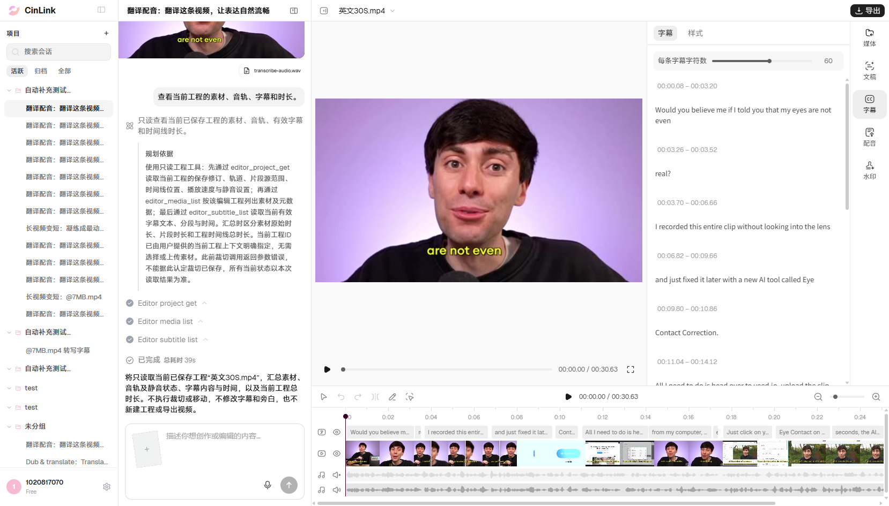

# B01 读取当前工程：正式环境执行结果

## 后续缺陷同步

2026-11-06按用户要求已提交[FWXC-349](https://devops.aliyun.com/projex/project/1e401ac99539c3999e00e40006/bug#viewIdentifier=1dedc5afd44979211cad516f&openWorkitemIdentifier=146528783d86252d98bb53bb98)：Agent读取工程任务已完成，但未返回实际汇总。沿用无需查重偏好，仅新建1条；1张本轮真实失败截图已上传并在正文末尾嵌入，另附1份脱敏JSON。正文/字段、附件ID/名称/字节数及图片引用回读通过。[本地缺陷与附件清单](../../../defects/CINLINK-ERYE196-READ-SUMMARY-001.md)。本次未重跑用例；下文“不提交云效缺陷”描述原执行批次，最新同步状态以本节为准。

## 原执行记录

2026-11-06，使用已打开的有头Chrome和用户创建的“英文30S.mp4”执行一次。**结果：Failed；任务状态done。** 三个只读工具均成功，但助手没有向用户返回实际素材、音轨、字幕或时长清单，只显示执行前的计划说明。不能因工具成功或工程未变而判B01通过。

## 前置与操作

| 项目 | 本轮实际值 |
|---|---|
| 环境 | 正式环境 https://app.cinlink.ai/ |
| 会话 | [用户已创建的会话](https://app.cinlink.ai/c/9500f848-2da3-4dd4-be21-43149cd5fd29) |
| 编辑工程 | 英文30S.mp4；`a4c860bc-f50d-4f73-9b20-7c31ca2dd748` |
| 保存基线 | 版本2；视频30.6306秒；独立旁白音源0～28.975193秒；原声静音；13条英文译文字幕绑定；无BGM、逐句配音条目 |
| 本轮入口 | 已打开的持续测试窗口，Agent输入框仅发送一次；没有新建浏览器、会话或工程 |
| 提交时间 | 2026-11-06 17:15:23，Asia/Shanghai |
| run_id | `run_v2_3f68ce46e80b48c0b9e00c02596476b2` |
| trace_id | `4a5a9057-73c8-4b19-8a9b-11cc07b8c7c3` |
| 脚本 | [single-action-basics.mjs](../../../../tools/editor/single-action-basics.mjs)，`runB01`；[已有窗口调用方式](../../../../tools/editor/README.md#b01单动作读取自动化复用已打开窗口) |

完整提示词：

```text
查看当前工程的素材、音轨、字幕和时长。
```

发送后等待原任务结束，回读本轮消息和已保存工程；随后刷新同一标签页并等待用户工程实际加载完成，核对工程、内容、版本及是否重复提交。没有发起第二个B01任务，没有点击重试，没有编辑或覆盖用户工程。

## 实际与预期

| 检查项 | 本轮结果 |
|---|---|
| 工程读取 | `editor_project_get` done |
| 素材读取 | `editor_media_list` done |
| 字幕读取 | `editor_subtitle_list` done |
| 工具异常/写入 | 没有失败步骤；只调用上述三个读取工具 |
| 任务与目标标记 | done；intent_fully_satisfied=true，但不代表用户收到读取结果 |
| 实际结果汇总 | **未提供**：回复没有实际视频时长、音轨静音值、字幕清单及数量等读取值 |
| 工程保持 | 执行前、执行后及刷新后内容一致，版本2→2→2 |
| 刷新恢复 | 完成加载后仍是同一用户工程；刷新期间未观察到新的turns提交 |
| 补槽/业务重试 | 0 / 0；实际受理1个run |
| 最终断言 | 12项检查中9项满足、3项未满足；整例Failed，不拆分算多条用例 |
| 浏览器 | 原窗口保持打开，当前仍为用户工程 |

任务done后，助手实际回复为：

> 将只读取当前已保存工程“英文30S.mp4”，汇总素材、音轨及静音状态、字幕内容与时间，以及当前工程总时长。不执行裁切或移动，不修改字幕和旁白，也不新建工程或导出视频。

页面和原run延后回读仍为这段说明，没有补充实际读取结果。预期应基于已成功的只读结果，向用户展示当前视频/素材、原声静音、独立旁白、有效英文字幕及实际时长；同时保持工程不变。当前失败点是**读取后没有形成用户可见的实际结果汇总**，不是本轮读取工具失败，也没有证据确定内部根因。

## 截图与验证边界

下面是本轮真实失败截图：左侧可见B01指令、三个工具完成及未提供实际值的助手回复，右侧为用户工程和30.63秒预览。截图未改画面；归档副本与原图SHA256一致。



- [脱敏结果、逐项检查及截图哈希](evidence-B01-prod-20261106/B01-summary.json)。PNG：523367字节，SHA256 `16389c5358386a0eac510d3c78327cbd7ce7aa6d207c43b03c4e6169ed029134`。
- 原始工程、消息、页面文本及过程截图仅保存在本机`reports/editor-196/20261106-prod-B01/`，不复制原始接口内容或带签名链接到提交物。
- 首次刷新探测曾捕获“空白工程／正在打开工程”的临时加载画面。已修正脚本等待实际工程名后，仅复核同一run及刷新，不重新发送任务；最终刷新检查通过。初次探测文件本机单独保留，不将加载占位误判成项目丢失缺陷。
- 字幕列表为虚拟化渲染，当前DOM行数不等于总数；不据此报告字幕丢失。B01的失败已经由缺少任何实际读取汇总确认。

本次只执行B01；B03已有单视频裁头失败保持，B02及其他22项未执行。基础清单现为0 Passed / 2 Failed / 22 Not Run，其中B01已接固定浏览器内自动化、其余23项未接本清单固定脚本。原ERYE-196预发134条和原001完整用例历史成绩不变，本次单动作正式分支不重复计数。不执行多任务组合，不修改云端代码，不提交云效缺陷。
