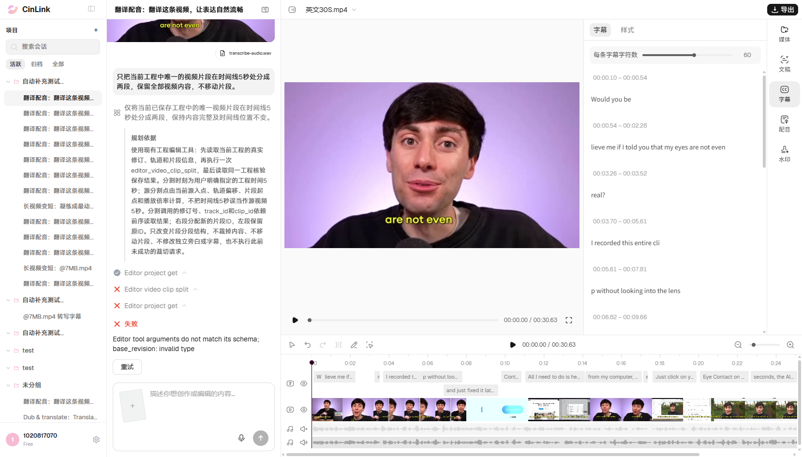

# B02 单视频5秒分割：正式环境执行结果

## 后续缺陷同步

2026-11-06按用户要求已提交[FWXC-350](https://devops.aliyun.com/projex/project/1e401ac99539c3999e00e40006/bug#viewIdentifier=1dedc5afd44979211cad516f&openWorkitemIdentifier=96fde22e756e50026ec43649fa)：Agent在5秒处分割视频失败，base_revision为未解析模板字符串。沿用无需查重偏好，仅新建1条；本轮加载稳定后的真实失败截图已上传并嵌入正文末尾，另附1份脱敏调用JSON。正文/字段、2附件ID/名称/字节数及图片引用回读核验通过。[本地缺陷及附件清单](../../../defects/CINLINK-ERYE196-VIDEO-SPLIT-001.md)。本次未重跑B02；下文“没有云效变更”描述原测试批次，最新同步状态以本节为准。

## 原执行记录

2026-11-06，使用已打开的有头Chrome和用户创建的“英文30S.mp4”执行一次。**Failed，任务failed**：工程读取成功，但`editor_video_clip_split`收到未解析的`base_revision`模板字符串，实际报`base_revision: invalid type`，未完成分割。

## 前置与提示词

| 项目 | 本轮实际值 |
|---|---|
| 环境 | 正式环境 https://app.cinlink.ai/ |
| 会话 | [用户现有会话](https://app.cinlink.ai/c/9500f848-2da3-4dd4-be21-43149cd5fd29) |
| 工程 | 英文30S.mp4；`a4c860bc-f50d-4f73-9b20-7c31ca2dd748` |
| 本轮已核对基线 | **版本18**；保留用户此前的字幕手动分段和时间修改，不套用旧版本2内容 |
| 待分割视频 | 唯一完整片段；源0～30.6306秒、时间线起点0、速度1；1920×1080、29.97fps |
| 视频轨道／片段 | `edit_728d71cfd1bf701ea515f155b0185015`／`edit_3970e98669ed3c7a1d90576b82bf781b` |
| 其他对象 | 原声静音；独立narration音轨；英文字幕父块绑定13条，另含已保存手动排版diff；不以绑定数或虚拟DOM行数冒充当前可见分段总数 |
| 提交时间 | 2026-11-06 17:40:05，Asia/Shanghai |
| run_id | `run_v2_aec40ab42ad14b9792b26e618bd1d1b4` |
| trace_id | `5f6b4eed-9dc1-4dde-bb87-cadd428543bc` |
| 脚本入口 | [single-action-basics.mjs](../../../../tools/editor/single-action-basics.mjs)中的`runB02`；[原窗口调用说明](../../../../tools/editor/README.md#b02单动作视频分割自动化复用已打开窗口) |

只发送一次：

```text
只把当前工程中唯一的视频片段在时间线5秒处分成两段，保留全部视频内容，不移动片段。
```

执行步骤：核对当前选中工程和唯一视频前置 → 一次发送上述指令 → 等待原run终态 → 回读已保存片段及完整内容 → 刷新同一会话、重新展开原工程并等待加载 → 核对保存结果与是否重复提交 → 保留真实截图。没有新建浏览器、会话或工程，没有直接写入工程JSON。

## 实际结果与卡点

| 检查项 | 本轮结果 |
|---|---|
| 首次工程读取 | `editor_project_get` done |
| 分割工具 | `editor_video_clip_split` failed，实际错误码`INVALID_ARGUMENT` |
| 错误原文 | `Editor tool arguments do not match its schema; base_revision: invalid type` |
| 分割后的计划内工程读取 | failed／`RUN_FAILED`，跟随前一步失败；本地独立回读工程成功 |
| 已保存视频 | 仍为原来的1段，源0～30.6306秒、时间线起点0，未形成0～5秒与5～30.6306秒两段 |
| 内容与版本 | 执行前、执行后、刷新后及最终回读完整内容一致，版本18→18→18；字幕与旁白保持 |
| 切点播放抽检 | **Not Run**：分割未完成，不使用原片播放来冒充分割后切点通过 |
| 恢复清理 | **NotNeeded**：本轮没有修改工程，不执行撤销，避免撤掉用户既有编辑 |
| 实际提交／补槽／业务重试 | 1 / 0 / 0；仅跟踪原run，未点击重试 |
| 窗口 | 原Chrome保持打开，仍为用户工程；刷新没有产生新的turns提交 |

本轮分割调用的实际关键值：

```json
{
  "base_revision": "{{steps[0].result.revision}}",
  "parameters": {
    "track_id": "{{steps[0].result.content.video_tracks[0].track_id}}",
    "clip_id": "{{steps[0].result.content.video_tracks[0].clips[0].clip_id}}",
    "timeline_time_sec": 5
  }
}
```

上例为便于阅读展开后的实际参数摘录；原请求的`parameters`是JSON字符串，完整形式见脱敏JSON。`base_revision`实际没有解析成工程修订值，轨道/片段参数也保留占位表达式；不是本轮读取缺失工程。具体模板解析/绑定环节仍待研发定位，不据此断言某一内部代码根因。

预期是同一原视频变为两段：源0～5秒和5～30.6306秒、时间线起点0和5秒；速度、总内容与顺序保持，切点连续，保存及刷新一致，再实际播放抽检切点两侧。本例只覆盖视频分割单项，不替代原ERYE196-010的完整声音/字幕联动验收。

## 失败截图与证据

下图为本轮页面加载稳定后的真实失败截图：左侧是B02提示词、读取成功、分割失败及错误；右侧保留用户当前字幕编辑，时间线上视频仍为完整一段。画面中的字幕分段是本轮前置已有的修改，不是本轮视频分割产物。



- [执行前截图](evidence-B02-prod-20261106/B02-before.png)；[初次结果截图](evidence-B02-prod-20261106/B02-failed.png)；[脱敏结果与实际调用](evidence-B02-prod-20261106/B02-summary.json)。3张PNG均为本轮原始截图，归档副本与原图逐一核对SHA256一致。
- 主失败截图508079字节，SHA256：`c92f42edbdc7dd93f7a1138da8deeda213b419260878e18fecd7c27543abb611`。
- 原始任务、完整工程及页面证据仅留本机`reports/editor-196/20261106-prod-B02-current/`。

最初检查时工程从版本11更新到18，脚本在发送前停止，没有受理B02；核对变化仅涉及既有字幕排版、确认当前保存稳定后，另建本轮证据目录并仅提交一次。最初前置探测留在本机`20261106-prod-B02`，不算一次业务执行或重试。

首次结果刷新后编辑器未展开，验证脚本等待超时；已补齐通过原页面入口展开原工程的步骤，仅复核同一run与保存结果，没有重发B02。刷新后字幕资源异步加载完成的截图另存为主失败图。超时和临时空面板不据此记为项目丢失或字幕丢失缺陷。

## 进度口径

本轮仅B02执行1次Failed，原B01及B03失败保持。基础清单最新**0 Passed / 3 Failed / 21 Not Run**；B01/B02共2项接入固定浏览器内自动化，其余22项未接本清单固定脚本。原ERYE-196预发134条仍5 Passed / 2 Not Applicable / 8 Failed / 0 Blocked / 119 Not Run，010既有历史成绩保持，正式单项分支不重复计数。

未执行其他基础项、组合任务或导出，没有云效变更或云端代码修改。
