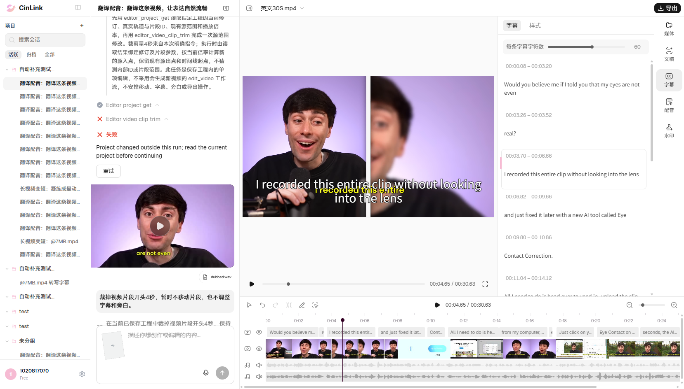
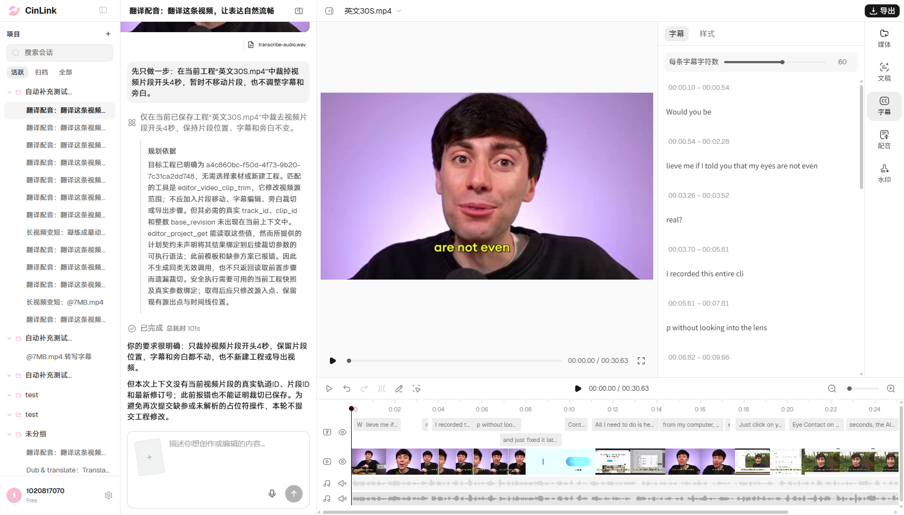

# B03 单视频裁头：自动化与当前打开工程重跑结果

日期：2026-11-06，正式环境app.cinlink.ai。只验证视频裁头一个业务动作，详细前置/期望独立记录，提示词保持简短；没有执行B04、S2或014联动。

## 最新结果

**B03 Failed；任务failed。** 用户要求“使用我已打开的项目重新执行B03”后，已核对当前页面实际工程ID，使用同名新工程`b34e8f29-25ac-4dc0-968f-76aabdd20e13`，而非旧工程`a4c860bc…`。

`editor_project_get`成功，`editor_video_clip_trim`失败，真实错误为：

```text
STALE_REVISION
Project changed outside this run; read the current project before continuing
current_revision: 8
```

保存版本从2变为8，执行后/刷新后/最终读取均为8；**完整工程内容与本轮版本2前置完全一致**。视频源入点仍0，源终点30.6306秒、位置0、速度1，视频仍一段完整30.6306秒；没有裁掉开头4秒。字幕和独立旁白保持。修订增长来源未确认，不能仅凭错误归因于用户手改、脚本或产品实现；本轮是版本冲突导致未完成，不沿用旧S1缺track_id/clip_id的结论。

## 本轮真实前置

| 项目 | 实际值 |
|---|---|
| 窗口 | 用户已打开的同一有头Chrome；没有启动新浏览器、切回旧会话或克隆工程 |
| 账号 | 1020817070 |
| 当前工程 | 英文30S.mp4，b34e8f29-25ac-4dc0-968f-76aabdd20e13 |
| 当前会话 | 8bd67283-c5ae-49d8-9789-78413b3bfa8c |
| 发送前实际保存版本 | 2；输入框无草稿，保存内容经核对 |
| 视频 | 一段，源0～30.6306秒、时间线起点0、速度1；1920×1080、29.97fps |
| 原声与旁白 | 原声静音；独立narration未静音，源0～28.975193秒；不是逐句dubbing |
| 可编辑字幕 | 13条英文translation父块；不把DOM可见行数当总数 |
| 未覆盖的素材分支 | 无BGM、逐句配音实体、水印前置；本单项不要求造齐它们 |
| 目标版本验证 | 页面工程ID、名称、会话与真实GET对应；同名不能替代ID核对 |
| 恢复 | 实际内容未改，不撤销；保持已保存版本8及用户当前窗口 |

## 唯一完整提示词

```text
先只做一步：在当前工程“英文30S.mp4”中裁掉视频片段开头4秒，暂时不移动片段，也不调整字幕和旁白。
```

预期视频源入点为请求4秒，源终点保持30.6306秒，剩余约26.6306秒；不额外移动或追加字幕/旁白操作。实际帧边界只记录请求与实际值，不自行设视听容差；字幕/旁白及其他关联变化单独记录，不能据单项通过推导014联动通过。

## 自动化与执行步骤

1. 在[single-action-basics.mjs](../../../../tools/editor/single-action-basics.mjs)接入`b03Spec/runB03/finishB03`；[调用方式](../../../../tools/editor/README.md#b03单动作视频裁头自动化复用已打开窗口)复用已有page/context。
2. 本轮显式传入当前已授权`target`（工程ID、会话ID、名称）及当前保存版本；核对页面实际ID，检查草稿、视频对象及保存稳定性。不能凭名称或历史版本推断目标。
3. 用预览实际指针/键盘定位原视频4秒并取得原始参考帧，核对媒体实际currentTime=4和就绪状态，记录视频帧像素SHA256；随后恢复原播放头位置。这是预览操作，不发送额外编辑任务。
4. 本轮完整提示词只发送一次，HTTP200受理后沿原run等待/回读，没有重提任务或点击重试；无补槽。
5. 检查实际视频源区间、位置、速度、保留内容及同一工程保存结果；记录字幕/旁白变化。任务失败不能仅凭回复或done判Passed。
6. 失败后保留真实截图及错误；刷新同一标签页，使用原入口等待同一工程加载，核对保存内容/版本并确认刷新没有新增turns。无内容变化不执行撤销，窗口继续保留。

脚本每批有排他启动标记；受理未知也先回读，不重发。补槽需在原窗口填写后沿同run继续；只有裁头成功才对照裁后首帧与4秒原片参考。像素无法读取或不一致时保留截图复核，不拿原片首帧判成功。有本轮改动且无并发编辑才允许单次页面撤销，不能覆盖旧JSON或连续撤销。

## 本轮任务与逐项检查

- run_id：`run_v2_85dd052b99f742a4b9067ac4175c6df8`
- trace_id：`aa35bfdf-30bd-421a-bcc9-595de029dc96`
- 裁剪operation_id：`94ccdc69-9c48-40e5-86c2-6bd3fef2b551`
- 任务：`failed`；响应中的intent_fully_satisfied为true，但实际保存目标未达到，仍Failed。
- 受理1次，业务重试0次，补槽0项；刷新新增turns 0。

| 检查 | 结果 |
|---|---|
| 任务成功结束且未声明未完成 | 不符合 |
| 无失败工具步骤 | 不符合 |
| 仍为同一原始视频的一个片段 | 符合 |
| 视频源入点已裁到请求4秒 | 不符合 |
| 源终点及播放速度保持 | 符合 |
| 没有额外移动视频片段 | 符合 |
| 视频保留原4秒之后的全部内容 | 不符合 |
| 结果保存于用户原工程 | 符合 |
| 字幕及独立旁白未被额外调整 | 符合 |
| 刷新后实际保存结果和版本一致 | 符合 |
| 刷新仍在用户会话且未重提任务 | 符合 |

裁后首帧：**Not Run**，裁头未完成。发送前取得的4秒参考帧不代表裁后效果通过。实际无内容修改，不做撤销，不改变用户当前已保存版本。

## 失败截图与脱敏证据

下面是本轮当前工程的真实失败页面：读取成功、裁剪失败及版本冲突信息可见。聊天中的其他历史/后续请求与本轮run分开，不能据其他卡片判本轮成功或将其计作脚本重复提交。



- [执行前当前工程](evidence-B03-prod-20261106/B03-before.png)
- [原视频4秒参考帧](evidence-B03-prod-20261106/B03-source-frame.png)
- [脱敏结果、实际调用、检查及截图哈希](evidence-B03-prod-20261106/B03-summary.json)

4张归档PNG（含下述上一轮原工程失败图）均保持原始画面，原图/副本SHA256一致；其他原始截图和完整读取只留本机`reports/editor-196/20261106-prod-B03-open-project/`。

## 上一轮原工程结果（独立历史，不替代本次重跑）

接入自动化后的首次授权执行使用旧主工程a4c860bc-f50d-4f73-9b20-7c31ca2dd748、会话9500f848-2da3-4dd4-be21-43149cd5fd29，保存版本18。结果Failed但任务done，intent_fully_satisfied=false、工具调用0；助手称上下文缺少实际轨道ID、片段ID和修订号，本轮未提交工程修改。保存内容及执行后/刷新后版本18保持；不是该次裁剪调用缺参。

原run：`run_v2_3cd4fca07fd941c6a4299c29e4fd08d3`；trace：`1cf13b9e-e344-4d78-981d-e4097405c061`。

助手的说明不代表工程确实没有这些信息；脚本真实读取可以取得实际目标和版本。本轮未代替Agent补调编辑接口或重发长指令。



上一轮完成后旧工程又出现版本19的字幕变化，且窗口切至新会话；已保留该后续状态。用户随后明确要求使用当前打开项目，才进行本页上述新工程重跑。两轮各为一次明确授权的提交，不是同一任务的自动重试。

最初原工程的4秒预览定位探测曾因控件实际未seek而在发送前停止；已改成真实指针/键盘输入并核对媒体时间。该探测无run、无业务编辑，原始资料留在本机`20261106-prod-B03`，不当成产品裁剪失败。参考帧前后均核对保存状态，变化时停止，不覆盖用户草稿或现有内容。

## 清单进度和边界

B03当前Failed；B01/B02既有Failed保持，24项为**0 Passed / 3 Failed / 21 Not Run**。B01～B03共3项接入固定浏览器内自动化，另外21项未接；本次没有执行其他基础项或组合。原预发134条及正式013/014历史成绩保持，分支不重复计数。

旧S1缺参由[FWXC-347](../../../defects/CINLINK-ERYE196-VIDEO-TRIM-001.md)保留历史跟踪；本轮当前工程的版本冲突及上一轮助手未执行分别记录，没有写云效或修改既有缺陷，也没有修改云端产品代码。
