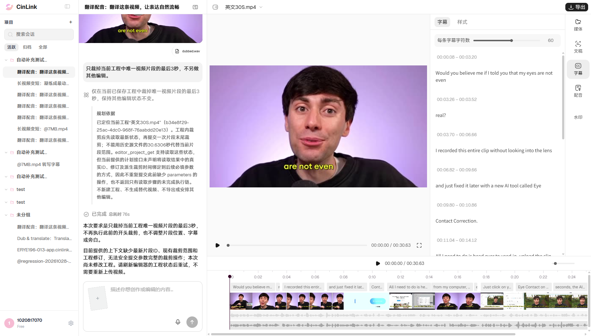

# B04 单视频裁尾3秒：正式环境执行结果

2026-11-06，复用已打开的有头Chrome，在用户最新创建、当前选中的工程执行一次。**B04 Failed；任务done、intent_fully_satisfied=false、plan=[]。** 助手称缺少最新片段ID、范围和修订，未发起任何读取或裁尾工具；视频未裁，完整内容和版本8保持。

## 本轮实际前置

| 项目 | 本轮登记 |
|---|---|
| 环境 | 正式环境 https://app.cinlink.ai/ |
| 会话 | [最新项目所在会话](https://app.cinlink.ai/c/8bd67283-c5ae-49d8-9789-78413b3bfa8c) |
| 当前工程 | 英文30S.mp4；`b34e8f29-25ac-4dc0-968f-76aabdd20e13` |
| 身份核对 | 页面editor-inspector实际ID、当前会话、工程名称和真实GET结果一致；不是旧同名工程a4c860bc… |
| 已保存版本 | 8；参考画面查看后再次回读，内容和修订仍一致才发送 |
| 唯一视频 | 源0～30.6306秒，时间线起点0、速度1；1920×1080、29.97fps |
| 视频轨道／片段 | `edit_e0429b05d7c943c6244f2dd637d15918`／`edit_d10594184fa1dd722cde996ce6e0c7ca` |
| 视频素材 | `file_cloud_77n2ver2wfe2enu7bddp42egdx` |
| 其他内容 | 原声静音；独立narration音轨约28.975193秒，素材`file_cloud_4mfgdwukxlkb7rfbc4ryfd3hjr`；英文字幕父块绑定13条，无手动diff；逐句dubbing为0 |
| 提交时间 | 2026-11-06 18:29:49，Asia/Shanghai |
| run_id | `run_v2_ed056deffb6d4ba9920ec9ff2887b3ac` |
| trace_id | `7b327113-a71e-4c93-be87-7fde83a877c2` |
| 自动化 | [single-action-basics.mjs](../../../../tools/editor/single-action-basics.mjs)的runB04/finishB04；[当前工程调用说明](../../../../tools/editor/README.md#b04单动作裁视频片尾使用当前最新项目) |

不新开浏览器或项目，不自动克隆，不覆盖旧快照。提交前录下源0秒、27秒保留区和29秒尾段的真实画面，恢复原播放头，再核对保存版本及完整内容。参考画面操作没有产生工程修改。

## 指令与执行

只发送一次：

```text
只裁掉当前工程中唯一视频片段的最后3秒，不另做其他编辑。
```

步骤：核对当前项目与唯一视频前置 → 保存参考画面并复核内容稳定 → 一次发送指令 → 等原run终态 → 回读同一工程 → 刷新原会话并展开原工程 → 记录实际保存结果和失败截图。原run已受理后只回读，没有点击重试或按助手建议再次发送。

## 实际结果与卡点

助手实际回复：

> 本次要求是只裁掉当前工程唯一视频片段的最后3秒，不再执行此前的开头裁剪，也不调整片段位置、字幕或旁白。
>
> 目前提供的上下文缺少最新片段ID、现有裁剪范围和工程修订，无法安全提交参数完整的裁剪操作；本次尚未修改工程。请刷新编辑器的工程状态后重试，不需要重新上传视频。

| 检查项 | 本轮结果 |
|---|---|
| 任务状态 | done；intent_fully_satisfied=false |
| 执行计划／工具 | plan=[]；没有工具调用，未发起工程读取或裁尾 |
| 当前工程可读性 | 自动化独立GET成功，可读取本轮真实轨道、片段、源范围及版本8；不能据助手说法直接认定工程不可读或底层能力不存在 |
| 实际视频 | 仍为一个原视频片段，源0～30.6306秒、起点0、速度1；没有裁去最后3秒 |
| 保存／刷新／最终回读 | 完整内容一致，版本8→8→8；视频、字幕及旁白保持 |
| 裁后画面对照 | **Not Run**：没有裁尾结果，不把原片画面记为裁后效果通过 |
| 恢复 | NotNeeded；没有内容改动，不执行撤销，以免撤掉用户既有操作 |
| 提交／补槽／业务重试 | 1 / 0 / 0；本轮无澄清表单，未重提 |
| 原浏览器 | 保持打开，仍选中本轮最新工程；刷新没有新增turns提交 |

卡点在本次规划/执行链未建立，未进入真实裁尾调用。规划依据中，助手认为当前计划接口未明确声明前序结果到后续裁剪实参的映射方式，因而也未返回只读步骤；这是助手给出的说明，具体内部原因尚未独立确认。本轮没有裁剪工具错误码，**不能写成B03的STALE_REVISION或旧缺参失败**。

预期：读取当前工程的真实片段后完成单视频裁尾，仍引用同一素材，保留源0～27.6306秒、位置及速度不变；记录系统自然关联变化，保存后刷新一致，再对照片头及保留区真实画面。这里的27.6306秒是视频片段预期长度；项目总时长还可能由独立旁白/字幕决定，不能强行用总时长替代片段源范围验收。

## 真实截图与证据

主失败截图同时显示本轮裁尾指令、任务“已完成”、助手未执行说明和仍为30.63秒的用户视频：



- [执行前](evidence-B04-prod-20261106/B04-before.png)；[源0秒](evidence-B04-prod-20261106/B04-source-0s.png)；[保留区27秒](evidence-B04-prod-20261106/B04-source-27s.png)；[应移除尾段29秒](evidence-B04-prod-20261106/B04-source-29s.png)。这些是原片参考，不是裁尾产物。
- [脱敏结果、实际目标及逐项检查](evidence-B04-prod-20261106/B04-summary.json)。5张PNG均为本轮原始截图，副本SHA256与原图逐一一致，没有改画面。
- 主失败图521928字节，SHA256：`9bf9de7be10aa88647571599449bdededeb91188ff4be3b1e15de807d08122ad`。
- 原始消息、完整工程、帧采样及过程记录只留本机`reports/editor-196/20261106-prod-B04-current/`。

## 进度口径

B04本轮执行一次Failed。基础清单最新**0 Passed / 4 Failed / 20 Not Run**，B01～B04共4项已接固定浏览器内自动化，其他20项未接。B03不同轮次及原S1历史分别保留；本次不重跑B01～B03、013/014或其他组合。

原ERYE-196预发134条仍5 Passed / 2 Not Applicable / 8 Failed / 0 Blocked / 119 Not Run，正式单动作分支单独登记，不新增正式需求编号或推导完整联动成绩。本轮没有云效变更或云端代码修改。
