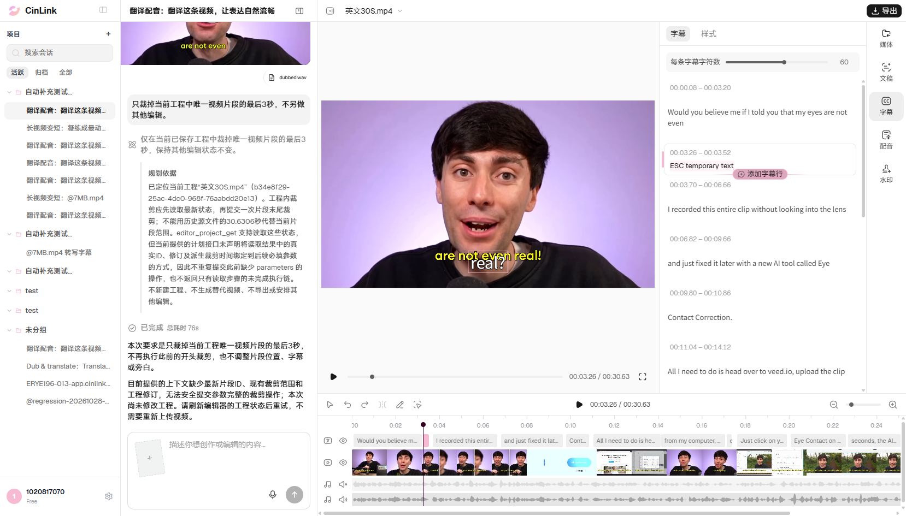

# 字幕编辑按Esc未取消，仍保留临时文字

状态：本地待同步云效；2026-11-06。编号：CINLINK-ERYE196-SUBTITLE-ESC-CANCEL-001；UI-83。

**现象**

正式环境字幕文字编辑时按Esc，输入框仍打开并保留临时文字，未取消本次编辑。

**前置步骤**

使用已登录测试账号、用户当前项目“英文30S.mp4”，工程b34e8f29-25ac-4dc0-968f-76aabdd20e13、会话8bd67283-c5ae-49d8-9789-78413b3bfa8c。保存版本144；有13条英文字幕，第2条为3.26～3.52秒real?，无其他未提交草稿。

**提示词**

无需提示词，直接操作编辑页。

**复现步骤**

1. 打开字幕面板，点击第2条real?进入文字编辑。
2. 输入ESC temporary text，暂不提交。
3. 在输入框内按Esc。

**实际结果**

输入框仍显示并保留ESC temporary text；未恢复real?。保存版本144→144、内容未变，无Agent run_id。留存截图后已清理本轮临时草稿，原文仍real?；最终工程恢复及刷新后版本150。

**预期结果**

用户本轮已明确Esc应取消本次编辑、退出输入状态并恢复原文字；不提交临时文字。

**影响**

用户无法通过Esc放弃当前文字编辑，临时文字继续停留于可提交状态。没有证据表明本轮临时文字已经错误保存，不扩大为数据丢失。

**补充**

字幕文件file_cloud_lkfnrgju55hbckpklpxbwhyfuy；父句cue_3b27e9b60eb5c52f885bfd53。按页面业务及用户确认预期验收，不依赖拟定接口契约；原图为UI-83本轮失败现场，左侧对话是历史记录。本批未向云效写入。

**失败截图**

